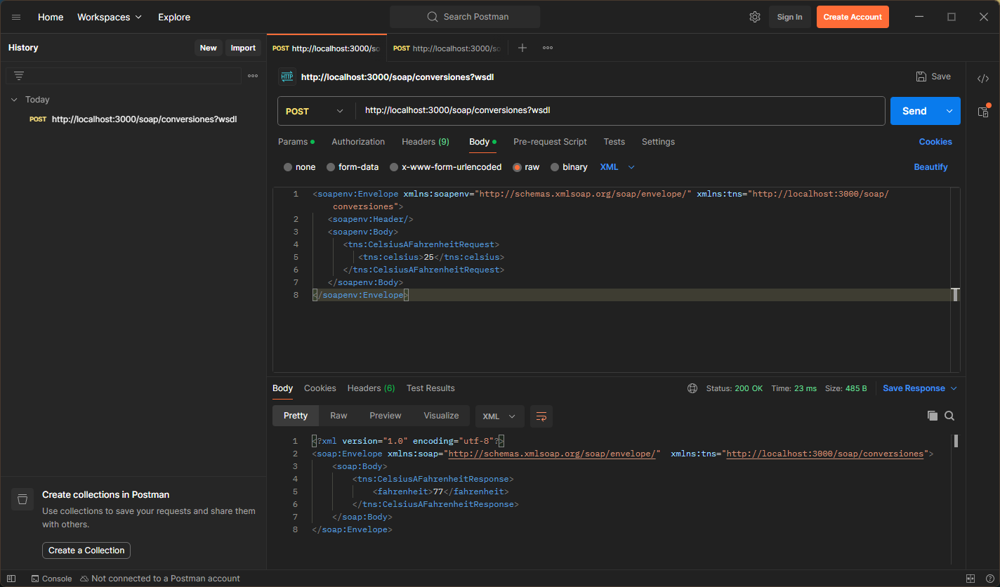
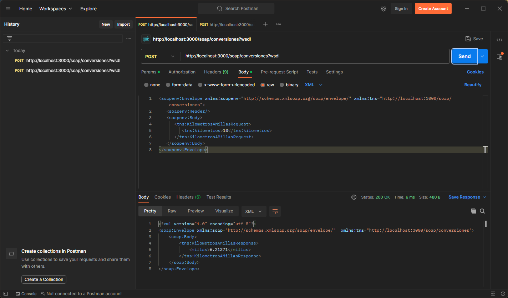
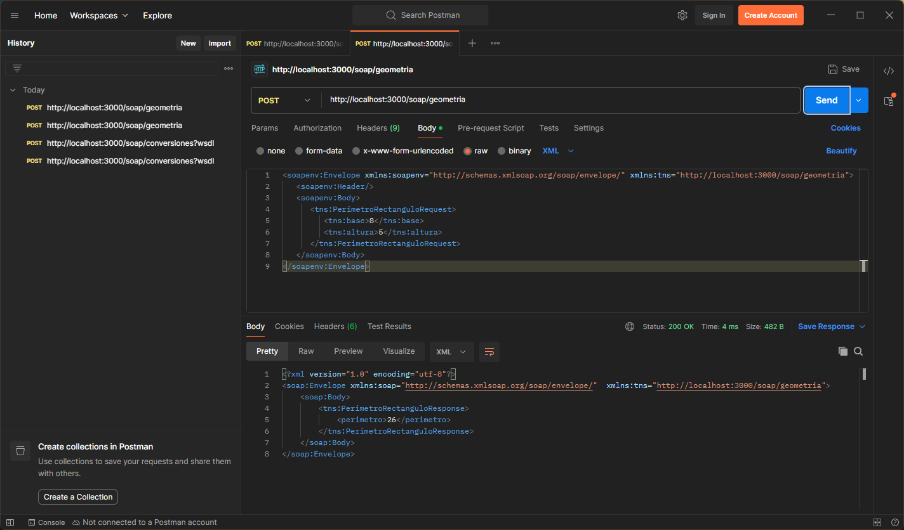
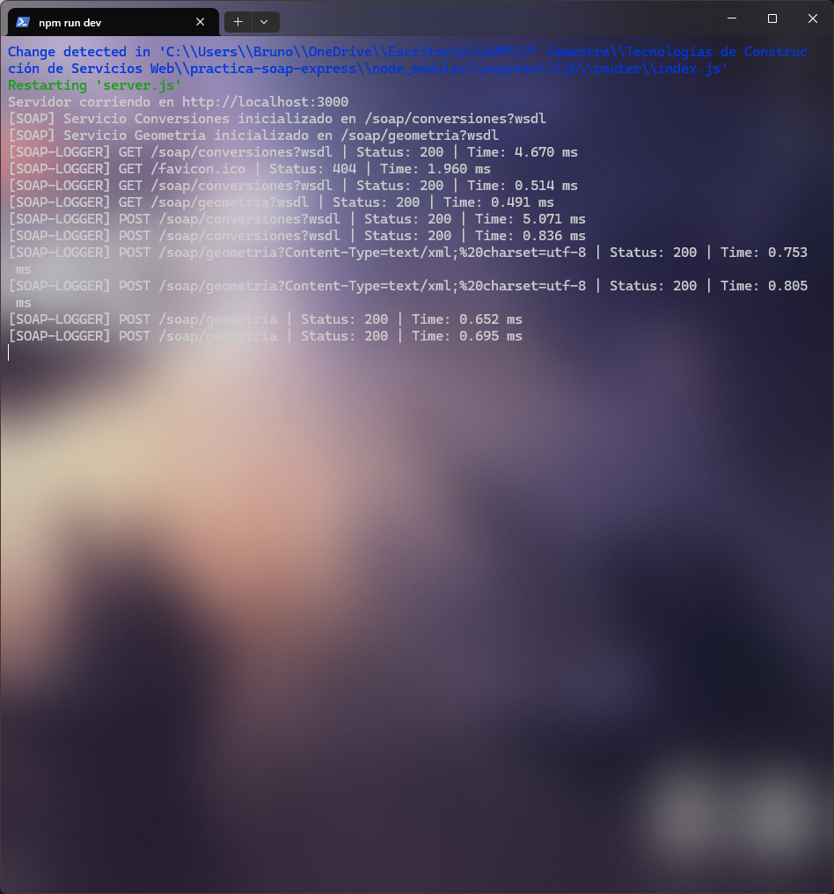

# Práctica: Servicios Web SOAP con Express y WSDL

Aplicación desarrollada en Node.js y Express que implementa dos servicios web basados en protocolo SOAP con contratos WSDL independientes, separación de rutas mediante Router y un middleware centralizado de registro de peticiones.

## Requisitos Previos
- Node.js (versión 18 o superior recomendada)
- Gestor de paquetes npm

## Instalación
1. Clona este repositorio.
2. Instala las dependencias ejecutando:
   ```bash
   npm install

### Evidencias de Pruebas

#### 1. Operación CelsiusAFahrenheit


#### 2. Operación KilometrosAMillas


#### 3. Operación AreaRectangulo


#### 4. Operación PerimetroRectangulo


#### 5. Registro del Middleware en Consola
